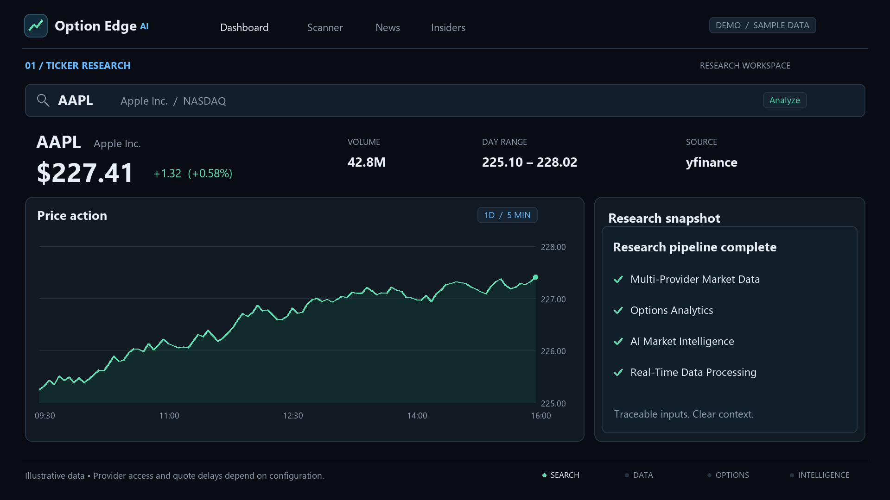

# OptionEdge AI

Probabilistic options-trading signal platform. Every number carries its source; every recommendation is labeled a forecast, not a guarantee.

**Not financial advice.** Signals are probabilistic. Past patterns do not guarantee future results. Markets can and do invalidate models without warning.

## What it does

OptionEdge AI pulls equity prices, option chains, news, and SEC insider filings from
a ranked list of market-data providers, scores each ticker with a deterministic factor
model, and presents the result as a directional signal with an explicit confidence
breakdown and a citation for every input.

### Features

- **Multi-provider data layer with automatic fallback.** Each domain (quotes, chains,
  news, macro) has a primary and ordered fallbacks, so one dead or rate-limited API
  does not take the app down.
- **Sourced values.** Every figure the UI renders carries the provider name, fetch
  timestamp, and source URL. Nothing is presented as an unattributed number.
- **Deterministic factor scoring** over trend, momentum, IV rank, option-chain skew,
  insider clusters, and news sentiment — with a per-factor contribution breakdown
  rather than an opaque score.
- **Local FinBERT news sentiment**, optional; no data leaves the machine.
- **Walk-forward backtesting** with win rate, profit factor, max drawdown, and Sharpe.
- **IV rank from a rolling history** backfilled from Alpaca option bars.
- **Background workers** with single-leader election, so running multiple API workers
  does not multiply provider calls.
- **Per-domain caching** (in-memory or Redis) with single-flight locking to prevent
  request stampedes against rate-limited providers.

## Demo

[](demo/option-edge-ai-demo.mp4)

*A rendered interface walkthrough using illustrative sample data, not a recording of
live market data. See [`demo/README.md`](demo/README.md).*

## Architecture

| Layer | Stack |
|---|---|
| Frontend | Next.js 15, TypeScript, Tailwind, TradingView Lightweight Charts |
| Backend | Python FastAPI |
| Data | SQLite (default) or Postgres; in-memory cache or Redis |
| AI | Deterministic factor scoring + local FinBERT news sentiment |

## Data sources & rate limits

| Domain | Primary | Fallback | Rate limit / notes | Key |
|---|---|---|---|---|
| Option chains + greeks + IV | Alpaca (indicative / free) | yfinance → Tradier sandbox | Alpaca ~200 historical calls/min; Tradier sandbox has OI/volume, **no greeks** | Alpaca (required for options slice) |
| Equity OHLCV | yfinance | Stooq → Twelve Data → Alpha Vantage | yfinance is an unofficial scraper and can break; Twelve Data ~800/day; Alpha Vantage **25/day — fallback only, never hot path** | No (keyless first) |
| News | Finnhub + RSS | — | Finnhub ~60 req/min | Finnhub optional |
| Insider Form 4 | SEC EDGAR | — | ~10 req/sec; requires descriptive `User-Agent` | No (User-Agent only) |
| Macro (CPI, GDP, yields, …) | FRED | — | Per FRED key quota | FRED optional |
| Polygon / Massive | Registered but **off** | — | Free tier ~5 calls/min EOD — unusable for a scanner | N/A |

Alpaca free options history starts **February 2024**. Historical bars are real OPRA (free tier only blocks the latest 15 minutes). Live quotes on the free plan are *indicative* — fine for signal generation, **not** for execution.

## Quick start (no Docker)

```bash
# 1. Env
cp .env.example .env
# Paste ALPACA_API_KEY_ID / ALPACA_API_SECRET_KEY into .env yourself — never commit them.

# 2. Backend
cd backend
python -m venv .venv
# Windows:
.venv\Scripts\activate
# macOS/Linux: source .venv/bin/activate
pip install -e ".[dev]"
# Optional if using Postgres instead of SQLite defaults:
# alembic upgrade head
uvicorn app.main:app --reload --port 8000

# 3. Frontend (second terminal)
cd frontend
npm install
npm run dev
```

Open http://localhost:3000. API docs: http://localhost:8000/docs.

The app boots with **no API keys at all** — keyless sources (yfinance, Stooq, RSS,
SEC EDGAR) cover prices, news, and insider filings. Adding keys unlocks option
greeks/IV (Alpaca), macro series (FRED), and richer news (Finnhub).

## Environment variables

Copy `.env.example` to `.env` and fill in what you have. `.env` is git-ignored and
must never be committed.

| Variable | Required | Default | Purpose |
|---|---|---|---|
| `ALPACA_API_KEY_ID` / `ALPACA_API_SECRET_KEY` | For options | empty | Option chains, greeks, IV history. Secret — server-side only. |
| `ALPACA_PAPER` | No | `true` | Use paper trading endpoints. |
| `ALPACA_DATA_FEED` | No | `indicative` | `indicative` (free) or `opra` (paid). |
| `FRED_API_KEY` | No | empty | Macro/economic series. Secret. |
| `FINNHUB_API_KEY` | No | empty | Company news and profiles. Secret. |
| `TRADIER_SANDBOX_TOKEN` | No | empty | Fallback chains (no greeks). Secret. |
| `TWELVE_DATA_API_KEY` | No | empty | Backup equity quotes. Secret. |
| `ALPHA_VANTAGE_API_KEY` | No | empty | Last-resort quotes, 25 calls/day. Secret. |
| `SEC_EDGAR_USER_AGENT` | Yes for EDGAR | placeholder | Your name + email. SEC throttles anonymous callers. Not a secret. |
| `DATABASE_URL` | No | SQLite file | SQLAlchemy async URL. Contains a password when using Postgres. |
| `REDIS_URL` | No | empty | Set with `CACHE_BACKEND=redis`. |
| `CACHE_BACKEND` | No | `memory` | `memory` or `redis`. |
| `CORS_ORIGINS` | No | `http://localhost:3000` | Comma-separated exact origins. Never `*`. |
| `API_KEY` | No | empty | When set, all `/api/*` routes require `X-API-Key`. Empty means the API is fully public. |
| `RATE_LIMIT_PER_MINUTE` | No | `120` | Per-client request ceiling. |
| `SCANNER_RATE_LIMIT_PER_MINUTE` | No | `10` | Tighter ceiling for the expensive scanner route. |
| `SCANNER_UNIVERSE` | No | 12 large caps | Comma-separated tickers to scan. |
| `WORKERS_ENABLED` | No | `true` | Run background refresh jobs. |

None of these are baked into the frontend bundle. `NEXT_PUBLIC_API_URL` is the only
browser-visible value and it is just the backend's address.

## Security considerations

This repository ships development defaults. Read [`SECURITY.md`](SECURITY.md) before
deploying anywhere reachable from a network. The short version:

- `API_KEY` is empty by default, so **every API route is public** out of the box.
  That is intentional for local use and wrong for a public deployment.
- Provider keys are read server-side only and are never sent to the browser.
- The rate limiter counts per socket address in-process; behind a proxy or across
  multiple workers, enforce limits at the proxy instead.
- Postgres and Redis in `docker-compose.yml` use a local-only default password and
  bind to loopback. Override `POSTGRES_PASSWORD` before using them for anything real.

## Testing

```bash
cd backend && pytest -q && ruff check app tests
cd frontend && npm run lint && npx tsc --noEmit && npm run build
```

## Known limitations

- **yfinance is an unofficial scraper.** It breaks whenever Yahoo changes its
  endpoints. Stooq, Twelve Data, and Alpha Vantage exist as fallbacks for this reason.
- **Confidence scores are heuristic, not calibrated.** Responses label this via
  `confidence_basis`. Treat `heuristic_uncalibrated` as a ranking aid, not a probability.
- **Alpaca free option history begins February 2024**, which caps how far back a
  backtest can reach.
- **Free-tier quotes are indicative**, not execution-grade.
- **Probability of profit is a delta approximation**, not a full risk-neutral model.
- No user accounts, portfolio tracking, or alerting yet — see `backend/app/stubs.py`
  for the planned interfaces.

## Optional: Docker

If you install Docker Desktop later:

```bash
docker compose up --build
```

Set `DATABASE_URL` and `REDIS_URL` as shown in `docker-compose.yml`. For Postgres schema management:

```bash
docker compose exec backend alembic upgrade head
```

Local SQLite still uses `create_all` on boot so the API starts without a migrate step.
If that DB already exists and you later introduce Alembic, sync once with:

```bash
cd backend && alembic stamp head
```


## Migrations

See `backend/alembic/`. Initial revision `001` creates `iv_snapshots`, `news_articles`, `insider_filings`, and `scan_results`.

## License

[MIT](LICENSE)

## Disclaimer

OptionEdge AI produces **probabilistic forecasts**, not certainties and not personalized investment advice. You are solely responsible for any trading decisions. Consult a licensed professional if you need advice.
